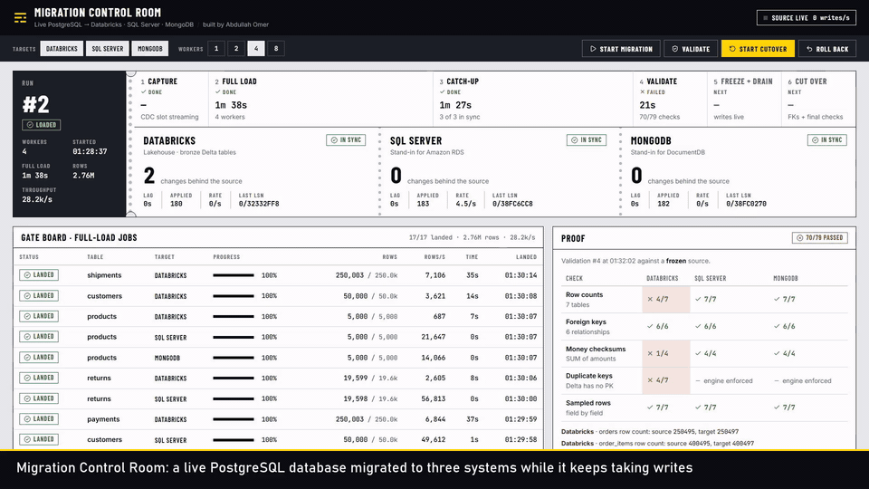
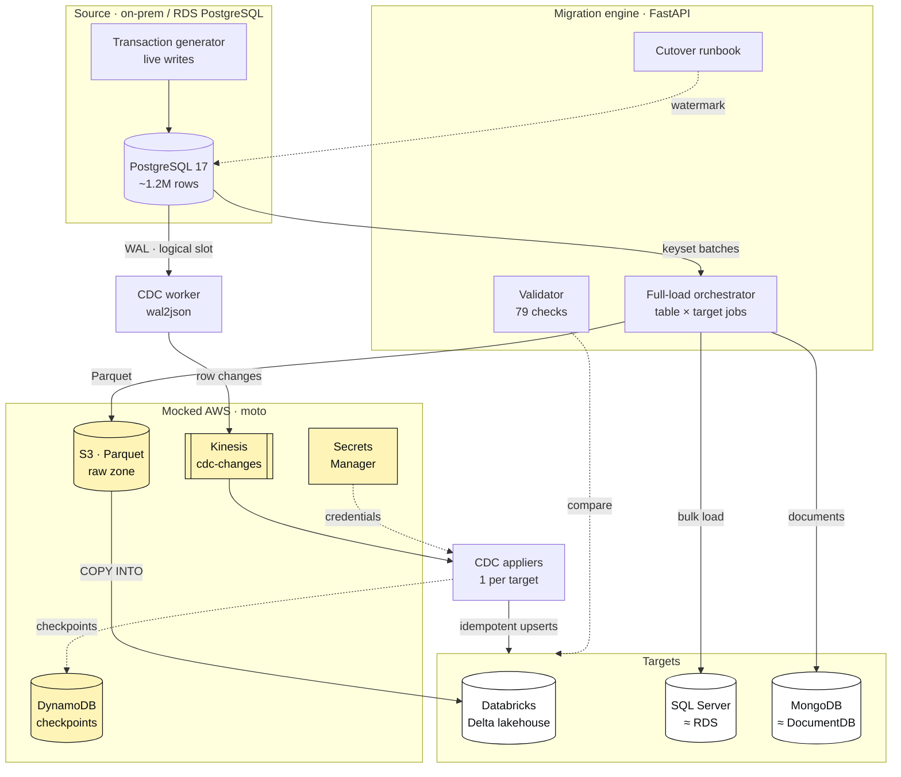
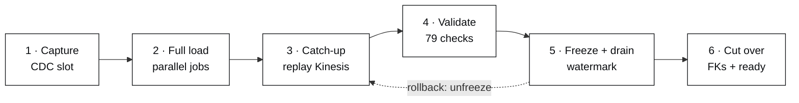
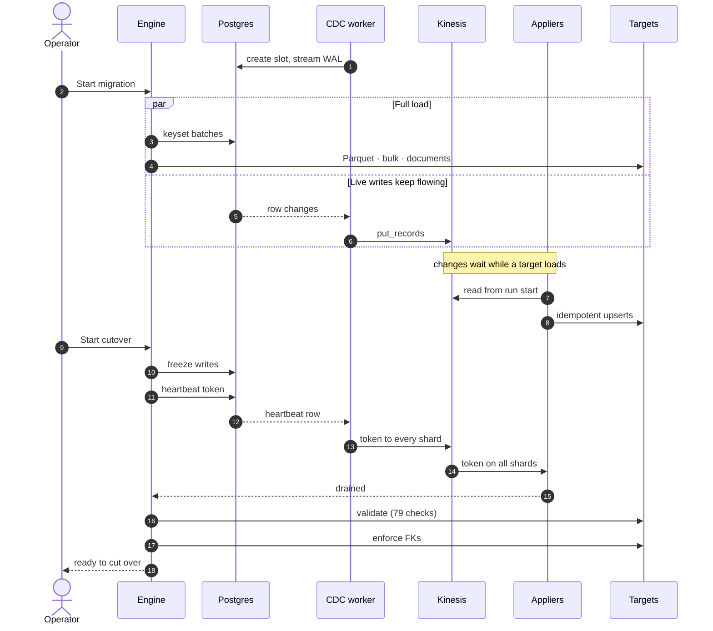
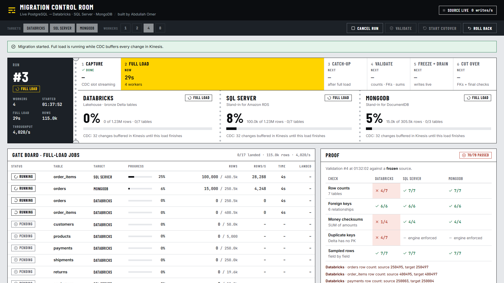
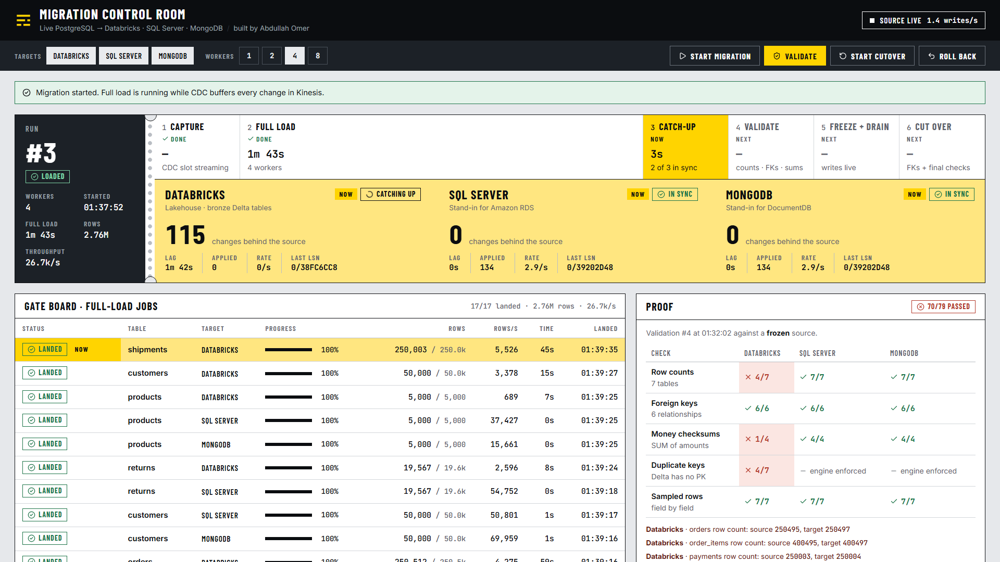
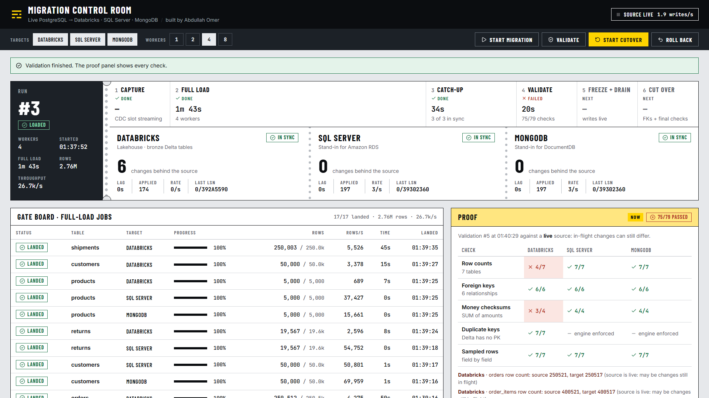
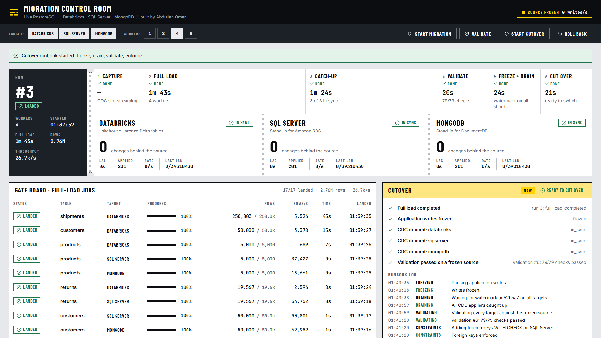
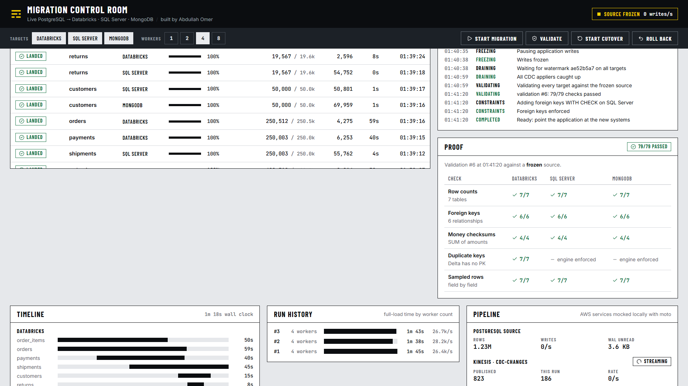
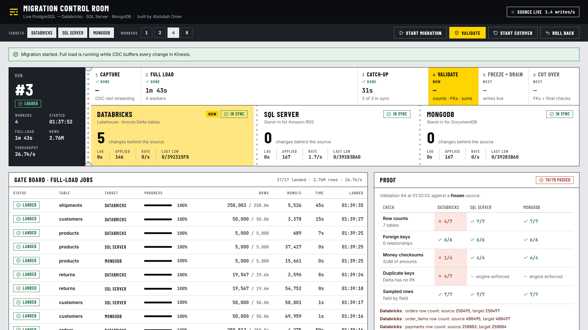

# Migration Control Room

**Migrating a live PostgreSQL database into Databricks, SQL Server and MongoDB at the same time, without losing a single change, and proving it before cutover.**




| Watch | |
|---|---|
| ▶ **[Full walkthrough video](docs/media/demo-walkthrough.mp4)** (1 min 42 s) | A real run recorded end to end: start, full load with live writes, catch-up, validation, cutover. Long waits are sped up and labelled. |
| ▶ **[Slideshow video](docs/media/demo-slideshow.mp4)** (1 min 20 s) | The same story as captioned slides, with the architecture and results. |
| 📄 **[Slide deck (PDF)](docs/media/demo-slides.pdf)** | 12 slides for presenting. |

---

## Results from the recorded run

These numbers come from the run in the video (run #3, 4 parallel workers), not from a benchmark:

| | |
|---|---|
| Source | PostgreSQL 17, **1.23M rows** in 7 tables, with a generator writing all the time |
| Full load | **2.76M rows** into 3 targets in **1 min 43 s** (≈ 26.7k rows/s) |
| Catch-up | All 3 targets in sync **34 s** after their full load |
| Final validation | **79 / 79 checks passed** on a frozen source |
| Cutover | Freeze → drain → validate → enforce foreign keys → **ready** |

## What this project demonstrates

- **Migration while the source keeps changing.** Change data capture starts *before* the copy, so every insert, update and delete made during the copy is replayed afterwards. Nothing gets lost and nothing is applied twice.
- **One source, three formats.**
  - Relational → lakehouse: Parquet → Delta tables, then dbt silver/gold.
  - Relational → relational: Postgres → T-SQL types.
  - Relational → documents: 7 tables become 3 MongoDB collections with nested orders.
- **Proof, not hope.** Each target is checked against the source with row counts, foreign keys, money checksums, duplicate keys and 200 sampled rows per table compared field by field. Cutover refuses to complete if any check fails.
- **Cloud-shaped, run locally.** S3, Kinesis, DynamoDB and Secrets Manager are mocked with [moto](https://github.com/getmoto/moto). The code uses plain `boto3`, so pointing it at real AWS only means removing one setting.

---

## Architecture



Data moves along two paths at once:

- **The full-load path** copies what is in the source now. The orchestrator reads keyset batches (`WHERE id > last_id ORDER BY id`) and writes each one to every target in that target's own format.
- **The CDC path** captures everything that changes from now on. The CDC worker reads the Postgres write-ahead log through a logical replication slot. Each row change becomes one Kinesis record, keyed by `table:pk` so all changes to a row stay in order. One applier per target replays them.

| Real AWS service | Local stand-in | Used for |
|---|---|---|
| Amazon S3 | moto · `migration-landing` | Raw zone: every Databricks load batch lands as Parquet under `raw/run=<id>/<table>/` |
| Amazon Kinesis | moto · `cdc-changes` (2 shards) | The CDC stream; buffers changes while a target is still loading |
| Amazon DynamoDB | moto · `cdc-checkpoints` | Applier checkpoints (shard sequence numbers), like the Kinesis Client Library |
| AWS Secrets Manager | moto · `migration/*` | Target credentials, with environment variables as fallback |
| Amazon RDS for SQL Server | SQL Server 2022 container | Relational target |
| Amazon DocumentDB | MongoDB 7 container | Document target |
| Databricks on AWS | Databricks Free Edition (real) | Lakehouse target: bronze, silver, gold |

> Databricks Free Edition cannot reach files on a laptop. Locally, each Parquet file is therefore also uploaded to a Unity Catalog volume before `COPY INTO`. On real AWS, Databricks would read the S3 files directly.

---

## How a migration runs



1. **Capture.** The CDC worker creates a logical replication slot (wal2json) before any copy starts. From that moment Postgres keeps every change, even while a worker is down.
2. **Full load.** One job per table × target, run on *N* parallel workers (17 jobs: 7 tables each for Databricks and SQL Server, 3 collections for MongoDB). Each job checkpoints its `last_id`, so an interrupted run resumes instead of starting over.
3. **Catch-up.** While a target loads, its changes wait in Kinesis. When the load finishes, the target's applier replays the stream from the run's start time. Every change is an idempotent upsert or delete, so replaying a change the copy already contains is harmless. The target converges to exactly the source.
4. **Validate.** Every target is compared with one consistent snapshot of the source.
5. **Freeze + drain.** Application writes are paused, and a watermark proves that every change has been applied (see below).
6. **Cut over.** The final validation runs on the quiet source, foreign keys are enforced on SQL Server, and the system reports ready. **Roll back** unfreezes writes, and CDC keeps the targets in sync.

### How the drain is proven

Waiting "a few seconds" is not proof. The cutover writes a heartbeat token into Postgres. The CDC worker sends that token to **every** Kinesis shard. An applier that has seen it on all shards has, by ordering, applied everything committed before it.



---

## Why these tools

| Tool | Role here | Why this choice |
|---|---|---|
| **PostgreSQL + wal2json** | Source and change capture | Logical decoding gives every committed row change as JSON in commit order. Numbers are sent as text, so `NUMERIC(12,2)` money never picks up float rounding. |
| **Kinesis** (moto) | CDC transport | A partition key of `table:pk` keeps changes to one row in order. Changes are buffered while targets load, can be replayed from a timestamp, and each target has its own independent consumer. |
| **DynamoDB** (moto) | Consumer checkpoints | The same pattern as the Kinesis Client Library: a restarted applier resumes exactly where it stopped. |
| **S3 + Parquet** (moto) | Raw landing zone | Typed, columnar and compressed. It keeps the exact decimals and timestamps, and Databricks loads it natively with `COPY INTO`. |
| **Databricks + Delta + dbt** | Lakehouse target | Bronze tables via `COPY INTO` and `MERGE`; dbt builds the silver and gold layers. `TIMESTAMP_NTZ` matches Postgres' timezone-less timestamps exactly. |
| **SQL Server** | Relational target (≈ RDS) | Shows type mapping across engines. Foreign keys are added `WITH CHECK` only at cutover, so a CDC child row can arrive before its parent during the load. |
| **MongoDB** | Document target (≈ DocumentDB) | Shows a real change of model: order items, payments, shipments and returns are nested inside each order. |
| **moto** | AWS account | No AWS account or cost. Since 2026 LocalStack needs an account and auth token, and its free tier is non-commercial; moto needs neither. |
| **FastAPI** | Migration engine | The orchestrator, validator and cutover runbook behind a small REST API. |
| **React + Vite** | Control room | The live dashboard: run pass, gate board of jobs, proof matrix, cutover log. See [DESIGN.md](DESIGN.md). |

## Correctness guarantees

- **Nothing is lost.** The replication slot exists before the copy starts. The CDC worker acknowledges a WAL position only after Kinesis has accepted the records.
- **Nothing is applied twice.** Delivery is at least once and every apply is idempotent:
  - Each micro-batch is collapsed to the last change per primary key.
  - Databricks uses `MERGE`, SQL Server uses `MERGE`, MongoDB uses upserts.
  - A plain `INSERT` is never blindly retried.
- **Ordering.** All changes to one row share a shard and are kept in commit order. MongoDB children that arrive before their parent create a placeholder order that the parent fills in. A return whose item has not arrived yet is retried.
- **Runs are fenced.** A new run does not reset any target until every CDC applier has acknowledged it. An applier re-checks its run before committing each batch.

  This fence came out of testing. In one recorded run, an applier's last micro-batch from the previous run landed in freshly reset Databricks tables, and the full load then wrote those rows again. That produced duplicate keys, because Delta Lake does not enforce primary keys. The validator caught it and the cutover refused to complete. Run #3 above is after the fix.
- **Validation covers each target's weak spots.**
  - Duplicate keys are checked only on Databricks, since SQL Server and MongoDB enforce keys themselves.
  - Money checksums catch rounding.
  - Sampled rows are compared at millisecond precision, because MongoDB stores dates in milliseconds.

## Screenshots

| | |
|---|---|
|  **Full load:** 17 jobs on 4 workers; CDC buffering in Kinesis |  **Catch-up:** targets replaying the changes made during the copy |
|  **Validation on a live source:** in-flight changes are flagged as such |  **Cutover complete:** every condition met, the full runbook log |
|  **Timeline, run history, pipeline:** sequential vs parallel, S3 and Kinesis |  **All targets in sync** before validation |

---

## Quick start

**Requirements**
- Docker Desktop with at least 6 GB of RAM (SQL Server alone uses about 2 GB).
- A Databricks Free Edition workspace with catalog `migration_platform` and schemas `bronze`, `silver` and `gold`. This is optional: untick Databricks in the dashboard to run without it.

```powershell
copy .env.example .env          # fill in DATABRICKS_HOST / DATABRICKS_TOKEN / DATABRICKS_HTTP_PATH
docker compose up -d --build    # 12 services: Postgres, moto, SQL Server, MongoDB, engine, CDC, dashboard...
docker compose run --rm seeder  # bulk-loads ~1.2M rows (prints per-step and total time)
```

Open **http://localhost:3000**, then:

1. **Start migration.** Watch the gate board, the route strip and the CDC backlog grow while the generator keeps writing.
2. Wait until all three targets show **In sync**.
3. **Validate.** On a live source a few checks may differ because of changes still in flight; the panel says so.
4. Build the lakehouse layers: `docker compose run --rm dbt dbt build --profiles-dir .`
5. **Start cutover.** Every readiness condition should turn green.
6. **Roll back** unfreezes writes so you can run the demo again. Try **1 worker** against **4 workers** and compare them in *Run history*.

<details>
<summary><b>Configuration (.env)</b></summary>

| Variable | Default | Meaning |
|---|---|---|
| `DATABRICKS_HOST` / `_TOKEN` / `_HTTP_PATH` | | Your workspace (host without `https://`) |
| `DATABRICKS_CATALOG` | `migration_platform` | Catalog holding `bronze`, `silver` and `gold` |
| `MIGRATION_TARGETS` | `databricks,sqlserver,mongodb` | Default targets for a run |
| `MIGRATION_WORKERS` | `4` | Parallel full-load workers (1 = sequential) |
| `GENERATOR_TPS` | `1` | Live write rate of the transaction generator |
| `SEED_SCALE` | `1` | Bulk seed multiplier (1 = about 700k extra rows) |
| `KINESIS_SHARDS` | `2` | Shards of the CDC stream |
| `VALIDATION_SAMPLE_SIZE` | `200` | Rows per table compared field by field |
| `MSSQL_SA_PASSWORD` | `Migrat1on_Passw0rd!` | SQL Server password (complexity rules apply) |

</details>

<details>
<summary><b>API</b> (full docs at http://localhost:8000/docs)</summary>

| Endpoint | Purpose |
|---|---|
| `POST /api/migration/start` | `{"targets": [...], "workers": 4}`: start a run |
| `POST /api/migration/resume` · `/cancel` | Resume from checkpoints, or stop after the current batches |
| `GET /api/migration/status` · `/runs` | Progress, timing and history |
| `POST /api/validation/run` | Full validation of every target |
| `GET /api/validation/readiness` | Cutover conditions |
| `POST /api/cutover/start` · `/rollback` | The cutover runbook |
| `GET /api/cdc/peek` | The latest CDC events on Kinesis |
| `GET /health/aws` · `/health/databricks` | Infrastructure checks |
| `GET /api/dashboard` | Everything the dashboard shows, in one call |

</details>

<details>
<summary><b>Project layout</b></summary>

```text
source-db/           Postgres 17 + wal2json image, schema, seed, bulk seeder, live traffic generator
cdc-worker/          CDC producer: WAL (wal2json) -> Kinesis, heartbeat fan-out
backend/app/
  targets/           databricks.py · sqlserver.py · mongodb.py behind one Target interface
  migration/         orchestrator (runs, workers, fence) · service (jobs) · landing (S3) · type mapping
  cdc/               applier (Kinesis -> target, DynamoDB checkpoints) · event decoding
  validation/        validator (5 check types) · readiness
  cutover.py         freeze -> drain -> validate -> enforce runbook
  aws_init.py        creates the mocked S3 / Kinesis / DynamoDB / Secrets Manager resources
frontend/            React + Vite dashboard (multi-stage Docker build, served by nginx)
dbt/                 silver and gold models on Databricks
docs/                demo videos, slide deck, screenshots
```

</details>

### Limits worth knowing

- moto keeps its state in memory. Restarting the `moto` container in the middle of a run loses the stream; start a new run afterwards.
- The four cross-engine targets share one laptop, so throughput figures show relative behaviour (sequential vs parallel), not production capacity.
- SQL Server and MongoDB are local stand-ins for RDS and DocumentDB; Databricks is a real Free Edition workspace.

---

Built by **Abdullah Omer**.
